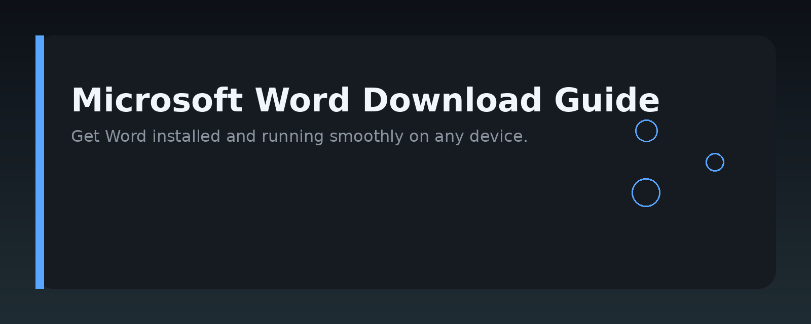
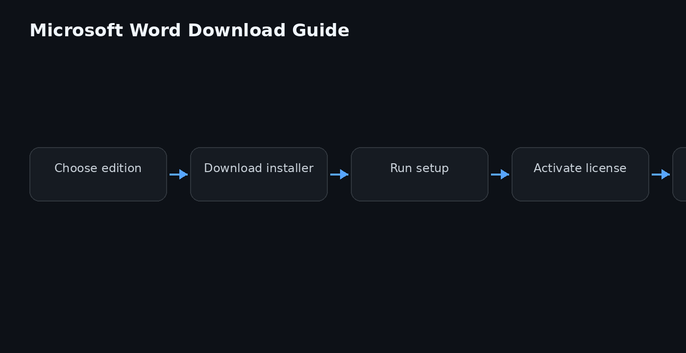

# Microsoft Word Download & Setup Guide




## Overview

This repository is a practical, developer-oriented guide to downloading, installing, and automating Microsoft Word. It covers official download sources, silent installation for enterprise deployment, and scripting patterns for managing Word documents programmatically. The goal is to give you a reliable reference so you never have to hunt for the correct Word download link or troubleshoot setup issues again.

## Why it exists

Most "Microsoft Word download" tutorials online are outdated, full of ads, or point to unofficial mirrors. This repo consolidates the essential facts: where to get Word legitimately, how to install it silently across many machines, and how to integrate Word document automation into your own tools. It exists to save you time and reduce risk when setting up Word in a development or IT environment.

## Core concepts

- **Licensing models**: Microsoft 365 subscription vs. one-time purchase (Office 2021/2024). Your download method depends on which license you hold.
- **Deployment tools**: Office Deployment Tool (ODT) for volume licensing, and the Click-to-Run installer for individual users.
- **Automation interfaces**: COM (Windows) and the Word object model for scripting macros, generating reports, and converting documents.
- **File formats**: `.docx`, `.doc`, `.dotx`, and how they affect compatibility with your scripts.

## Architecture

The setup and automation flow can be broken into three layers:

1. **Acquisition layer** – Where the installer comes from (official Microsoft servers via ODT or the consumer download page).
2. **Installation layer** – How Word gets onto the machine: interactive setup, silent install with XML configuration, or scripted deployment via SCCM/Intune.
3. **Automation layer** – How your code talks to Word: COM objects, PowerShell, Python (via `pywin32`), or VBA macros.

The image above (assets/architecture.png) shows this flow and the decision points you'll hit at each step.

## Practical workflow

Follow these steps to go from zero to a working Word installation with basic automation:

1. **Determine your license type.** If you have a Microsoft 365 subscription, sign in at office.com and download the Click-to-Run installer. If you have a volume license, download the Office Deployment Tool from the Microsoft Download Center.
2. **Create a configuration XML** for ODT. Specify the product ID (e.g., `ProPlus2021Volume`), the language, and the update channel.
3. **Run the installer silently.** Use `setup.exe /configure configuration.xml` for ODT, or the standard `setup.exe` for consumer installs.
4. **Verify the installation.** Check `winword.exe` exists under `C:\Program Files\Microsoft Office\root\Office16\`.
5. **Enable developer mode** in Word (File → Options → Customize Ribbon) to access VBA and COM automation.
6. **Write a small test script** (see Examples) to confirm you can open, modify, and save a document programmatically.

## Examples

### Silent install with Office Deployment Tool

```xml
<Configuration>
  <Add OfficeClientEdition="64" Channel="Current">
    <Product ID="ProPlus2021Volume">
      <Language ID="en-us" />
    </Product>
  </Add>
  <Display Level="None" AcceptEULA="TRUE" />
</Configuration>
```

Save this as `config.xml` in the same folder as `setup.exe`, then run:

```bash
setup.exe /configure config.xml
```

### Open and edit a Word document with PowerShell

```powershell
$word = New-Object -ComObject Word.Application
$word.Visible = $false
$doc = $word.Documents.Open("C:\temp\report.docx")
$doc.Content.Text = "Updated content"
$doc.Save()
$doc.Close()
$word.Quit()
```

### Convert a document to PDF with Python

```python
import win32com.client

word = win32com.client.Dispatch("Word.Application")
word.Visible = False
doc = word.Documents.Open(r"C:\temp\report.docx")
doc.SaveAs(r"C:\temp\report.pdf", FileFormat=17)  # 17 = wdFormatPDF
doc.Close()
word.Quit()
```

## FAQ

**Is this the official way to download Microsoft Word?**  
Yes. The repo only references official Microsoft channels – the Microsoft 365 portal, the Office Deployment Tool download page, and the standard consumer installer.

**Can I use these scripts on a Mac?**  
No. The COM automation examples are Windows-only. On macOS you'd use AppleScript or the `JXA` bridge instead.

**What if I don't have a license?**  
You can use Word Online for free with a Microsoft account, but the desktop app requires a valid license. There is no legal free full desktop version.

**Why does my silent install fail?**  
Most often it's a mismatched product ID or missing language pack in the XML. Double-check the product ID against your license type and ensure the channel name is correct.

## License

This repository is released under the MIT License. See the [LICENSE](LICENSE) file for details.

Topic: `word-document-toolkit`
